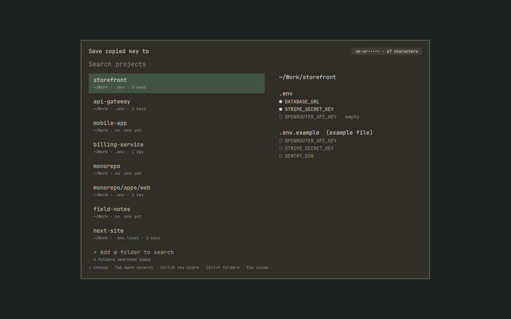
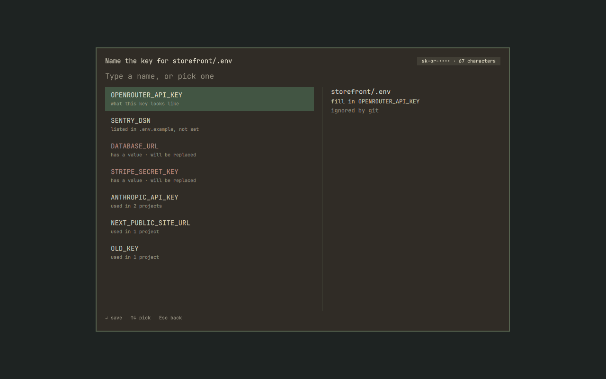
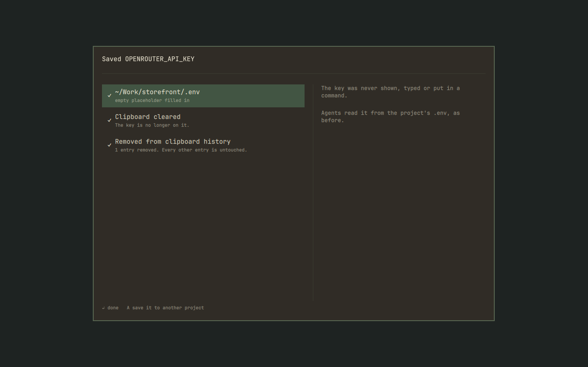
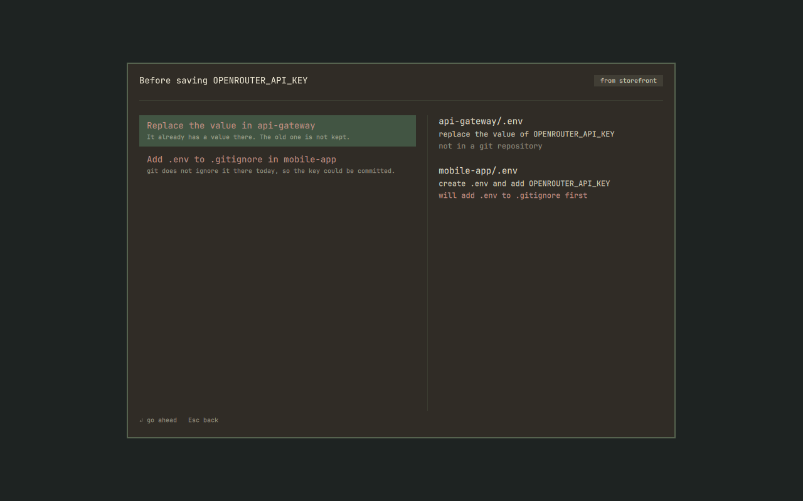
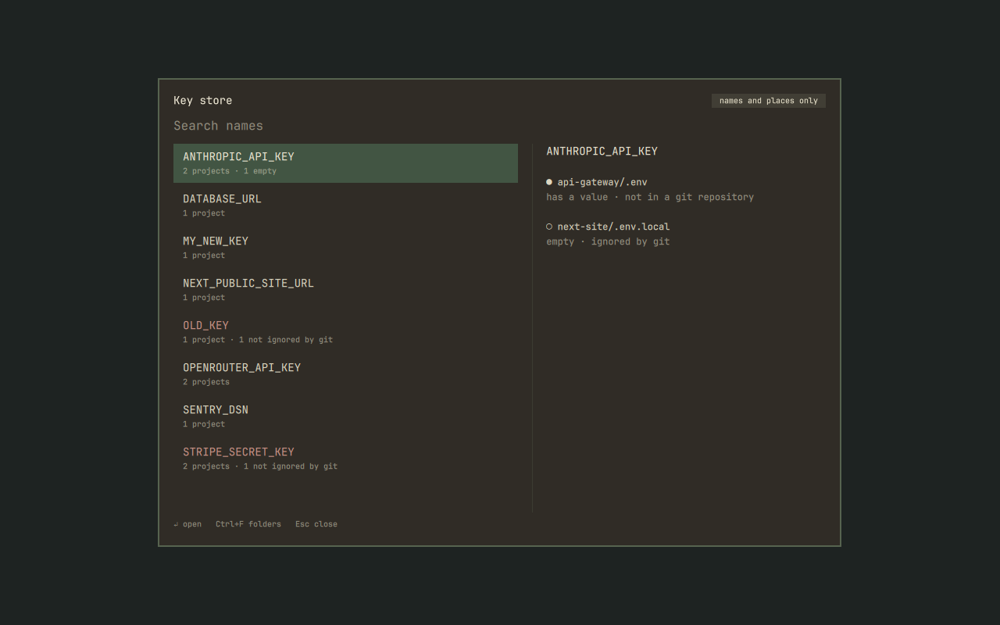
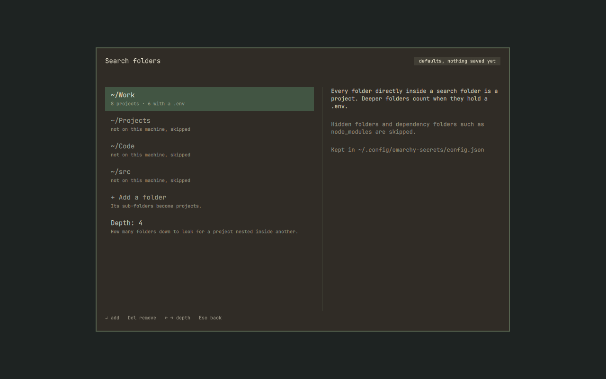

# Secrets, an Omarchy shell plugin

Press Copy on the site that shows an API key, press a hotkey, pick the project and name the key. It is written to that project's `.env`, the clipboard is cleared, and that one copy is taken out of Omarchy's clipboard history.



## The problem it solves

A key copied from a website sits on the clipboard, and Omarchy's clipboard manager keeps the last 500 copies in a plain file. Getting the key into a project then means pasting it into an editor, or into a chat with a coding agent, which is one more place it now lives.

This plugin moves the key from the clipboard to the file and removes it from both places it was passing through. The key is never typed, drawn on screen or passed to a program as an argument. Only its first few characters are shown, so you can tell which key you copied.

## How it goes

1. On the site, press **Copy**.
2. Press the hotkey. A card opens in the middle of the screen with your projects, most recently changed first. Type to filter.
3. Press Enter on a project. Pick a name for the key, or type one.
4. Press Enter. The card says what was written and what was cleaned up.



Names are offered in this order: what the key's own prefix says it is (`sk-ant-` is an Anthropic key, `ghp_` a GitHub token), names sitting empty in the file, names the project's `.env.example` lists, names the file already holds, and names your other projects use.



### The same key in several projects

Press Tab on each project before Enter, and the key is saved to all of them at once. After a save, press **A** to send the key on to more projects. That copy goes from the first file straight into the others, so it works even though the clipboard has been cleared.

### A project with no `.env`, or one git would commit

A missing `.env` is created, readable by you alone. When git does not ignore the file, the card stops and says so, and Enter adds the file to `.gitignore` before the key is written. A file git already tracks is refused, because ignoring it would not untrack it.



Only git is checked. In a folder under Mercurial, Jujutsu, Subversion, Fossil or Pijul the card says it cannot tell whether the file stays out of version control, and leaves that to you.

A project that keeps its keys in `.env.local` gets them there. Press Tab in the naming step to switch files.

### The key store

Press Ctrl+K in the card for every key name found in your projects and where each one lives. Values are never shown. From a key you can send it to another project, or copy it to the clipboard marked as sensitive, which the clipboard manager does not record.



### Search folders

Press Ctrl+F to choose where projects are looked for. The defaults are `~/Work`, `~/Projects`, `~/Code` and `~/src`; folders that do not exist are skipped. Each folder directly inside a search folder is a project, and a folder up to four levels further down is one too when it holds a `.env`. The list is kept in `~/.config/omarchy-secrets/config.json`.



## Install

Needs an Omarchy with shell plugins (built and tested on 4.5), `jq`, `git`, and a `wl-copy` that knows `--sensitive` (wl-clipboard 2.3 does).

```
omarchy plugin add https://github.com/parker-brown-family/omarchy-secrets-plugin.git --enable
```

Then give it a key. In `~/.config/hypr/bindings.lua`:

```lua
o.bind("SUPER + CTRL + SHIFT + K", "Save copied key", { panel = "brownfamilysports.secrets" })
hl.layer_rule({ match = { namespace = "^omarchy-secrets$" }, no_anim = true, animation = "none" })
```

## Remove

```
omarchy plugin remove brownfamilysports.secrets
```

Then delete the two lines you added to `~/.config/hypr/bindings.lua`, and, if you made them, the two links in `~/.local/bin` and the folder `~/.config/omarchy-secrets`. Your `.env` files stay exactly as they are.

## What it reads and writes

- **Reads** the clipboard when the card opens, and the names (never the values) in `.env` files under your search folders.
- **Writes** the `.env` file you pick, and a `.gitignore` beside it only after you say yes to that.
- **Edits** `~/.local/state/omarchy/clipboard-history.json`, Omarchy's own clipboard history, to take out the one entry that is the key you just saved. Nothing else in it is changed.
- **Keeps** its own settings in `~/.config/omarchy-secrets/config.json`, written the first time you change the search folders.
- **Runs** `git` to ask whether a file is ignored, and `wl-paste`, `wl-copy`, `jq`, `find`, `awk` and `notify-send`. It makes no network connection.

## For coding agents

Two commands do the work, and the card is a face on them. Put them on your `PATH` and an agent can ask for a key without ever seeing it:

```
ln -s ~/.config/omarchy/plugins/brownfamilysports.secrets/bin/secret-take ~/.local/bin/
ln -s ~/.config/omarchy/plugins/brownfamilysports.secrets/bin/secret-keys ~/.local/bin/
```

```
secret-keys has OPENROUTER_API_KEY     # exit 0 when ./.env has a value for it
secret-take OPENROUTER_API_KEY --wait  # asks you to copy it, then saves the next key copied
```

`secret-take` prints the name, the file and what happened. It exits 3 when git does not ignore the file, 4 when nothing that looks like a key was copied, and 5 when the file is read-only. `secret-take --help` and `secret-keys --help` list the rest.

## What it does not do

- It does not encrypt anything. A `.env` is the same plain file it was before.
- It removes a clipboard history entry only when the entry is exactly the key. A longer entry that contains the key, such as a whole `curl` command, is left alone.
- It shows a few leading characters of a key so you can tell which one you copied: a known prefix such as `sk-ant-`, or otherwise an eighth of the key, four characters at most.
- It refuses a value with a space or a single quote in it, because `.env` readers disagree on how to quote those.
- It speaks English only.

## Tests

```
bash tests/run.sh          # the two commands, against a fake clipboard
node tests/model.test.js   # the card's logic
bash tests/ui.sh           # the card itself, driven by key presses on a private display
```

None of them touch your clipboard, your clipboard history or your files. The last one needs `xvfb-run`, `xdotool` and ImageMagick, and writes a picture of every step to `tests/shots`.

## Credit

The rule that an agent passes a name and never holds the value comes from [secret-safe-env](https://glama.ai/mcp/servers/irrenwill/secret-safe-env), a Windows tool. Nothing of its code is used here.

MIT licence.
